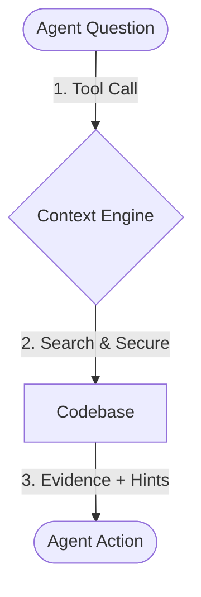

# Octocode: The Forensic Research Engine for the Enterprise

**Stop Searching. Start Investigating.**

**I built Octocode for one simple reason: to make the AI do the heavy lifting of code research instead of me.**

Octocode is the Model Context Protocol (MCP) server that transforms AI coding agents from simple assistants into forensic researchers. In the era of massive monorepos and scattered microservices, standard retrieval isn't enough. You need an engine that understands the *why* and *how* of your code, not just the *where*.

## 1. Shattering Information Silos in the Enterprisea

**The Problem:** In large organizations, code is data—but it's fragmented across thousands of repositories, hidden in microservices, and locked in "tribal knowledge."

**The Solution:** Octocode treats your entire organization as a unified knowledge graph. It bridges the gap between disparate repos, allowing agents to trace dependencies, logic flows, and architectural patterns across the entire enterprise in a single session. It solves the "fragmented knowledge" crisis, turning your messy codebase into structured, queryable intelligence.

## 2. The Detective Engine & Context Engineering

Octocode doesn't just "grep" for strings; it investigates. It equips agents with structured, evidence-based tools to navigate complex systems.

**Context Engineering:** AI agents often fail because they lack direction. Octocode fixes this by enforcing **Context Engineering**. Every tool call requires a `researchGoal` and `reasoning`, forcing the agent to maintain a coherent investigative thread. It acts as a GPS for your codebase, providing "Investigative Hints"—dynamic, context-aware suggestions that guide the agent through a logical sequence of discovery, validation, and implementation.

## 3. The Toolbox: A Complete Forensic Suite

Octocode provides a comprehensive set of tools divided into local workspace forensics and global GitHub intelligence.

### Local Investigation (Forensics at home)
Supercharge your agent's immediate environment with tools optimized for LLM consumption, delivering structured YAML outputs instead of raw text.

| Tool | Description | Key Features |
|------|-------------|--------------|
| `localSearchCode` | Advanced code search using ripgrep | Regex support, context lines, .gitignore respect |
| `localViewStructure` | Directory visualization | Tree view, depth control, file filtering |
| `localFindFiles` | Metadata-based file finder | Find by name, size, time, permissions |
| `localGetFileContent` | Precise content extraction | Read full files or specific line ranges/contexts |

### Global Intelligence (GitHub & Packages)
Don't just look at your machine; look at the world. Connect your agent directly to GitHub's API to audit libraries, find usage examples, and debug against upstream.

| Tool | Description | Key Features |
|------|-------------|--------------|
| `ghSearchCode` | Cross-repository code search | Search organizations, users, or specific repos |
| `ghViewRepoStructure` | Remote repository mapping | Explore folder structures without cloning |
| `ghGetFileContent` | Remote file retrieval | Fetch specific lines or full content from any public/private repo |
| `ghSearchRepos` | Repository discovery | Find projects by topic, language, or stars |
| `ghSearchPRs` | History & Blame analysis | Search PRs, view diffs, and understand change context |
| `npmSearch` | Dependency intelligence | Locate NPM/PyPI packages and their source repositories |

## 4. Solve Hard Problems: What You Can Ask

Octocode empowers your agent to answer questions that previously required hours of manual digging. Here is what a forensic agent can solve for you:

**Architectural Forensics**
*   "How do the internal frameworks work in my organization?"
*   "Describe the complete lifecycle of a complex transaction flow across services."
*   "How does this legacy feature actually work under the hood?"

**Root Cause Analysis**
*   "Here is a stack trace. Detect the root cause by tracing these calls across repositories."
*   "Find the solution to this bug by searching for similar issues or PRs in the platform repositories."

**Implementation & Best Practices**
*   "What is the standard way to implement a new UX flow in our design system?"
*   "Where is the database schema that stores these specific user events?"
*   "Find the best practices for error handling in this microservice."
*   "How can I build an AI agent using our internal best practices?"

**Team & Integration**
*   "How do I better integrate my service with the payments team's API?"

## 5. Built-in Battle-Tested Commands

Octocode isn't just a bag of tools; it comes with built-in, battle-tested commands (MCP Prompts) designed to standardize complex workflows. These predefined routines orchestrate multiple steps to ensure consistent, high-quality results:

*   **Research:** A comprehensive workflow for deep-dive analysis and Pull Request reviews. It forces the agent to gather context, understand dependencies, and verify assumptions before proposing any changes.
*   **Generate:** A focused command for producing production-ready code, tests, or documentation based on the forensic evidence gathered during the research phase.

## 6. Enterprise-Grade Security

Security isn't an afterthought; it's the foundation. Octocode is built with a defense-in-depth model designed for the enterprise:

*   **Automatic Redaction:** Over 100 regex patterns to detect and scrub secrets (API keys, tokens) in real-time.
*   **Strict Confinement:** Path validation to prevent directory traversal outside allowed scopes.
*   **Safe Execution:** Secure command builders to block injection attacks.
*   **Read-Only by Default:** The MCP server is designed for research, minimizing accidental destruction.

## 7. Architecture & Efficiency

Octocode is designed for speed and cost-efficiency in LLM interactions:

Octocode is designed for speed and cost-efficiency in LLM interactions:
*   **Bulk Operations:** All tools support batching (1-5 queries per call) to reduce round-trips.
*   **Token Efficiency:** Outputs are minified and formatted in YAML to save context window space.
*   **Graceful Degradation:** Robust fallback chains (e.g., `ripgrep` → `grep`) ensure the agent always gets results.

---

**Octocode isn't just a tool—it's the missing link between your AI and your organization's collective intelligence.**

For more information visit [octocode.ai](https://octocode.ai) 🔍🐙
