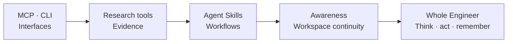
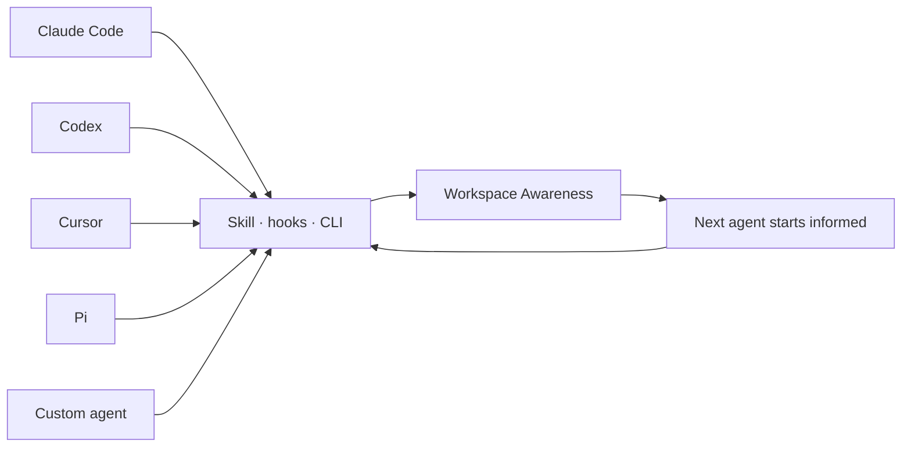
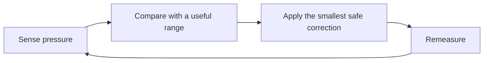

# From Code Research to a Self-Improving Repo

## How Octocode combines an evidence-first research platform with a homeostatic awareness layer for coding agents

[image: octocode-research-awareness-hero]

**Photo prompt:** Wide editorial technology photograph of a developer workstation at night, one screen showing a precise code graph and evidence trails while a second screen shows a calm shared-work dashboard; subtle teal and amber light, realistic materials, no vendor logos, no readable code, generous negative space for the article title.

I started Octocode for a personal reason: I needed a system that could do code
research for me. I wanted an agent that would stop guessing from filenames and
snippets, investigate the real code, follow its history, compare other
implementations, and return with evidence I could trust.

That solved an important problem, but not the whole problem. Research can tell an
agent what the code says. It does not teach every way of thinking about the work,
remember what happened after the research, or help several agents continue from one
another.

Now I am trying to turn Octocode into what I think of as a **whole Engineer**. Not a
single immortal model or a simulated personality, but an engineering system that
knows how to investigate, choose a method, use the right tools, remember verified
work, and continue across agents and sessions.

That system has four connected parts. **MCP and the CLI are interfaces**: two ways
for agents, developers, and scripts to reach the platform. **Research tools are the
evidence layer**: they inspect code, history, packages, semantics, and artifacts.
**[Agent Skills](https://agentskills.io/what-are-skills) are workflows**: reusable
ways to brainstorm, research, design, review, and improve. **Awareness is the missing
continuity layer**: it lets the workspace carry plans, coordination, verification,
and learning after any one agent stops.

## The thesis we are testing

Our thesis is that a repository can support successive coding agents better when
three capabilities are joined: evidence-first tools, reusable workflows, and
bounded operational awareness. Research should ground the next action in code and
history. Skills should guide how the work is approached. Awareness should preserve
coordination, verification debt, and reusable learning without loading the whole
past into every prompt.

This is a thesis under active implementation and evaluation—not a claim that the
repository already improves itself. We have runtime contracts, tests, smoke flows,
and bounded-output checks. The important proof still has to come from real use:
fewer rediscoveries, fewer harmful collisions, less unresolved verification debt,
leaner context, and better software over repeated tasks.

## Octocode: an evidence-first research platform

[Octocode](https://github.com/bgauryy/octocode) brings local workspaces, GitHub
history, npm packages, code semantics, and binary artifacts into one research flow.

**MCP is the agent-facing interface.** It brings Octocode's research capabilities
into a compatible AI client, so the agent can investigate code without leaving its
working conversation.

**The CLI is the direct interface.** Developers can use it from the terminal, skills
can drive it as part of a workflow, and agents without MCP can call the same research
engine. MCP and the CLI are two entrances to the same platform, with the same
safeguards—not separate implementations.

Behind those interfaces, the research tools span five useful surfaces:

| Surface | What an agent can establish |
|---|---|
| **Local workspace** | Search code and structure, browse files, and read exact source or artifacts |
| **GitHub** | Research repositories, pull requests, commits, reviews, and implementation history |
| **Packages** | Inspect package metadata and trace a dependency back to its source |
| **Code semantics** | Follow definitions, references, call paths, symbols, and types |
| **Unified research** | Connect evidence across local code, remote repositories, packages, history, and diffs |

A native engine keeps large searches fast and can show the shape of a file before
spending context on every line. The same security and redaction boundary applies
whether the request came from a developer at the terminal or an agent through MCP.

This changes the normal agent workflow. Instead of guessing from a filename or one
search snippet, an agent can map the repository, search narrowly, read the exact
implementation, follow semantic connections, and inspect the history or external
pattern that explains it. Results preserve their sources and make missing evidence
visible. Octocode turns code into citable evidence.

Tools make actions possible. Skills turn those actions into repeatable ways of
working. The core workflow skills in the Octocode repository are:

| Workflow skill | What it contributes |
|---|---|
| **Research** | Investigates, reviews, or changes code through an evidence-first loop: orient, search, read exactly, validate, and verify |
| **Brainstorming** | Tests a fuzzy idea against evidence, prior art, opportunity, and failure modes before committing to it |
| **RFC Generator** | Turns a validated direction into a design decision, implementation plan, and measurable acceptance criteria |
| **Roast** | Provides blunt but evidence-backed code critique, prioritizing real risk over style complaints |
| **Octocode Skills** | Finds, evaluates, creates, and improves Agent Skills themselves |
| **Prompt Optimizer** | Makes prompts and agent instructions clearer, leaner, more reliable, and easier to evaluate |
| **Awareness** | Preserves shared plans, active work, communication, verification, and learning across agents and sessions |

The first six improve how an agent approaches a piece of work. Awareness adds what
the others cannot provide alone: continuity after the current agent or context
window disappears. It is the piece that turns a collection of tools and workflows
into a workspace that can keep learning how to work.

Developers can adopt the platform incrementally. They can use the CLI for direct
research, connect MCP to an existing assistant, install only the workflow skill they
need, or use the [Pi extension](https://github.com/bgauryy/octocode/tree/main/packages/octocode-pi-extension)
and [Octocode Agent](https://github.com/bgauryy/octocode/tree/main/packages/octocode-agent)
as a more integrated local engineering loop.

A normal research pass remains deliberately incremental: orient on the repository,
search broadly, read the exact implementation, follow the relevant symbols, inspect
history or prior art when intent is unclear, and only then edit and verify. This is
how Octocode turns research from an occasional detour into a repeatable development
step.

[image: octocode-evidence-engine]

**Photo prompt:** Documentary-style close photograph of an engineer studying a large codebase across two monitors, with abstract repository trees, pull-request history, and symbol connections reflected softly in the glass; natural desk texture, subdued studio lighting, technically serious rather than futuristic, no logos or legible private data.

But tools and workflows still solve only part of the problem.

## Why research and workflows are not enough

Research and workflow guidance still operate inside a particular run. They can tell
one agent what the code means and how to approach the work, but not what the next
agent should inherit after the work begins. The gap becomes more serious when
several agents run in parallel. They share the same filesystem, Git state, generated
outputs, and test environment, while each agent sees only its own conversation and
host lifecycle.

That exposes a class of repository risk. Two agents can make individually
reasonable but mutually incompatible changes. A finished patch can look complete
while its verification is still pending. A useful discovery can die with one
compacted session. A stale lesson can be copied forward because nobody
recorded the evidence that superseded it.

The motivation for Awareness is therefore not “give the model more memory.” It is
to make the repository's operational state inspectable: active intent, shared work,
sensitive exclusivity, peer communication, verification debt, and reusable learning.

Suppose an agent investigates a parser regression. Octocode can identify the parser
entry point, find every caller, compare the current implementation with an upstream
repository, and trace the pull request that changed the behavior.

The next session can still lose everything operationally important.

It may not know that another agent is already updating the parser tests. It may not
know that yesterday's patch was submitted but never verified. It may repeat an
experiment that already failed. If every detail is copied into an instruction file,
the repository eventually accumulates a large and stale prompt.

Chat history is a poor database for those facts. It is host-specific, difficult to
query, and easy to lose during compaction or handoff.

That is the problem [Octocode Awareness](https://github.com/bgauryy/octocode/tree/main/packages/octocode-awareness)
is designed to solve.

## Awareness: the operational plane

Octocode Awareness is a local coordination and learning runtime built from a CLI,
an Agent Skill, optional host hooks, and one shared local database.

It gives compatible coding agents a shared way to manage Plans and Tasks, declare
files under work, coordinate overlaps, protect sensitive changes, exchange signals,
record verification receipts, retain scoped lessons, and publish a bounded
workspace summary.

The workspace—not any individual agent—is the unit of awareness. Agents start,
compact, stop, or get replaced. The repository remains the durable subject, while
Plans, messages, verification, and reusable lessons remain available to the next
compatible participant.

This is not one private “agent database” per model. It is one Awareness store scoped
to the workspace, with agent and session identities recorded as participants. Those
identities provide attribution; they do not own the shared plan or the repository's
memory.

That is what makes cross-vendor collaboration possible. Several agents from
different vendors can work together in the same workspace: Codex, Claude Code,
Cursor, Pi, and custom agents can all use the same coordination state. They see the
same Plans, Tasks, active paths, exclusive locks, verification state, and message
threads instead of depending on one model's private chat history.

Agents communicate through structured, durable messages: requests, questions,
blockers, decisions, handoffs, and FYIs. They can reply in one thread, acknowledge
after acting, and resolve it when no work remains. Signals are peer evidence, not
remote commands. An agent still evaluates the message against current code and its
own task before acting.

The distinction between file presence and locking is fundamental.

Every edited path should have **advisory presence**: which run is working there and
why. Ordinary overlaps remain allowed. If one agent is changing parser behavior and
another is adding a test, both can see the overlap and continue when their changes
are compatible.

An **exclusive lock** is a separate, deliberate safety mechanism for work such as a
database migration, generated artifact, shared policy file, or non-mergeable rewrite.
Files are not owned by default. Awareness makes concurrent work visible before it
makes it exclusive.

Verification is equally explicit. Ending a Work run or submitting a Task creates
pending verification. After the agent executes the declared check, it records the
result; unfinished verification stays visible to later agents. Awareness does not
execute the test itself and cannot prove that an agent told the truth. It makes the
claim durable, attributable, and reviewable. Expiring abandoned coordination never
converts a run into success.

Returning to the parser example, the complete flow is now coherent. Octocode finds
the relevant code and history. Awareness shows that a peer is already touching the
tests. The agent declares advisory presence on the parser implementation, decides
that no lock is necessary, makes the change, runs the parser suite, records the
verification result, and preserves one scoped lesson if the result will help a
future run. Research grounds the change in evidence; Awareness preserves
continuity around it.

[image: shared-workspace-awareness]

**Photo prompt:** Editorial photograph of two developers working at separate desks in the same studio, both facing different parts of one shared wall-sized project board; visible colored markers suggest overlapping files, verification, and handoff without showing readable text; collaborative, calm, realistic, no robots and no brand logos.

## Installation is a three-layer integration

Awareness becomes most reliable when it is more than a CLI an agent happens to call
once. The portable integration combines a runtime, an Agent Skill, and host
lifecycle hooks.

The shared store answers **what survives**. It preserves workspace continuity after
a particular agent exits, without requiring a server or daemon.

The Agent Skill answers **when Awareness is relevant**. On a skills-compatible host,
it loads when the current task matches its purpose. It teaches the agent to check the
workspace, choose work, declare files, coordinate with peers, verify, and hand off.

Hooks answer **what should happen at lifecycle moments that agents can easily
forget**. They connect the agent host to the same Awareness runtime, so coordination
does not depend entirely on an agent remembering every step. Supported hosts connect
through hooks or an in-process integration; custom agents can call the runtime
directly.

After setup, each participant begins by checking a small workspace briefing that
shows what needs attention before the agent chooses its next action.

Hooks are optional, and manual CLI operation remains valid. Each host integration
should still be tested with an ordinary overlap, an exclusive conflict, and pending
verification.

For current installation steps, supported clients, and deeper documentation, visit
[octocode.ai](https://octocode.ai).

All of these agents converge on the same small protocol and workspace state without
sharing a private chat. New messages and peer changes can surface without repeating
unchanged context. A manual agent can obtain the same view through the CLI.

## Why call this homeostatic?

Homeostasis does not mean keeping a system frozen. It means **dynamic regulation
within a viable range**: sense deviation, compare it with a target, apply a bounded
correction, and measure again. We borrow that control vocabulary from physiology,
not a claim that a repository is biological ([Billman, 2020](https://pubmed.ncbi.nlm.nih.gov/32210840/)).

The useful sequence is **sense → compare → act → remeasure**.

That framing matters because apparently valuable resources become harmful when
maximized. Too little context causes rediscovery; too much context hides the next
decision. Too little coordination causes collisions; too much locking serializes
safe parallel work. Too little memory repeats failures; too much memory adds noise
and increases the attack surface. Too little verification hides defects; too many
unbounded reminders become unusable debt.

The design treats these as regulated pressures, using runtime sensors for shipped
signals and explicit review gates for claims that still require evaluation:

| Pressure | Sensor | Bounded correction | Guard |
|---|---|---|---|
| **Context** | Briefing and workboard output size | Compact briefings and details loaded only when needed | Never hide errors, approvals, or continuation state |
| **Coordination** | Active Tasks, file presence, locks, signals | Declare work, contact a peer, lock only sensitive paths | A lock does not authorize an edit or prove success |
| **Verification** | Pending and stale work | Run the declared check and record its result | Ending or expiring work is never success |
| **Memory** | Weak recall, duplicates, stale evidence | Record, supersede, archive, or preview cleanup | Recalled memory remains a lead |
| **Projection** | Snapshot size and staleness | Refresh a bounded workspace summary | The local database remains the source of truth |
| **Harness** | Recurring failure signatures and recorded eval receipts | Propose a small skill or instruction change | Human approval and regression checks |

The loop is event-driven, not autonomous. Work senses and acts. Verification
creates an error signal. Reflection preserves only reusable outcomes. Maintenance
previews stale state. Projection publishes a snapshot only when file readers need
one. Re-measurement decides whether the intervention helped.

There is no background mind and no automatic policy rewrite.

[image: homeostatic-repository]

**Photo prompt:** Macro editorial photograph blending an illuminated circuit board with restrained organic branching patterns, a single soft pulse traveling through the network to suggest regulation and feedback; dark neutral background, realistic photography, scientific and understated, no glowing brain, no fantasy biology.

## Canonical state, sparse prompts

One of the harder design problems is preserving complete coordination without
turning it into permanent prompt tax.

Long-context models do not use every token equally well. In
[Lost in the Middle](https://aclanthology.org/2024.tacl-1.9/), performance often
degraded when relevant information appeared in the middle of a long context.
Awareness therefore separates what is stored from what is injected.

The local database keeps the canonical current operational state plus bounded audit
receipts and retained history. The prompt receives only what is needed for the next
decision. Ordinary edits add no prompt context unless coordination, verification,
maintenance, or relevant-memory state changes. Changed peer state appears once,
large lists are summarized honestly, and deeper guidance loads only when the current
task needs it.

We deliberately avoid presenting one token snapshot as a general product result.
Token counts vary with the tokenizer, selected skill content, live database state,
query, and workspace. The durable design claim is behavioral: discovery stays
short, detailed guidance loads only after it is needed, startup context remains
bounded, and unchanged workspace state adds nothing new to the prompt.

Token efficiency is therefore part of system health, not cleanup performed after
the design is finished. Whether these controls reduce end-to-end cost on real work
is another part of the thesis we still need to evaluate.

## Why hooks matter

A skill can teach the collaboration loop, but knowing a workflow is not the same as
invoking it at the right moment. Hooks turn a best-effort instruction into an
event-linked habit.

Awareness therefore has two kinds of trigger. A **skill trigger** loads the operating
guidance when the current task matches Awareness. A **lifecycle trigger** reacts to
events from the agent host. Both enter the same collaboration loop.

The database is neither an agent nor a trigger. It is the shared record that those
actions read and update. That separation matters: the skill supplies judgment, the
hooks supply timing, and the workspace supplies continuity.

Before an edit, a hook can declare file presence and stop a real exclusive conflict.
After an edit, it can record activity. At stop or handoff, it can surface unfinished
verification and preserve continuity for the next agent. These are reflexes, not
authority: hooks cannot approve a change, claim that a test passed, or rewrite
repository policy.

## What is actually new?

The honest answer is: not the primitives.

Research through MCP also has strong prior art. The
[Sourcegraph MCP server](https://sourcegraph.com/mcp) offers cross-repository code
intelligence, the [GitHub MCP Server](https://github.com/github/github-mcp-server)
exposes GitHub operations, and tools such as
[Serena](https://github.com/oraios/serena) provide local semantic navigation.
Persistent task graphs exist in [Beads](https://github.com/gastownhall/beads).
[MCP Agent Mail](https://github.com/Dicklesworthstone/mcp_agent_mail) provides agent
identities, mail, file reservations, guards, and Beads integration.
[Claude Code Agent Teams](https://code.claude.com/docs/en/agent-teams) provides a
lead, shared tasks, direct messaging, and team lifecycle hooks.
[OACP](https://oacp.dev/docs/getting-started/overview/) defines file-based,
runtime-neutral messaging, task lifecycles, review gates, handoffs, and durable
memory without a server. Reflection without weight updates is a
known research direction, including
[Reflexion](https://arxiv.org/abs/2303.11366). Feedback over shared knowledge also
has deep roots in autonomic computing and MAPE-K
([Kephart and Chess, 2003](https://doi.org/10.1109/MC.2003.1160055)).

We should not claim to have invented shared memory, task claiming, agent mail,
file leases, hooks, verification, or feedback control.

The differentiated bet is the **composition**:

1. an evidence-first research plane exposed through the same MCP and CLI engine;
2. a shared operational plane that works across different agent hosts;
3. visible file work by default, with exclusivity reserved for sensitive changes;
4. verification that remains separate from coordination expiry;
5. bounded context and repository learning kept behind human review.

That integration is unusual and, we think, useful. It is not evidence that the
system improves software yet. The novelty claim is a product and systems claim,
not a claim to have discovered new control theory.

Our closest practical comparison is Agent Mail combined with Beads. Our closest
conceptual comparison is MAPE-K. The delta is the evidence-to-continuity stack:
proof-oriented research, operational coordination, verification, bounded context,
and supervised learning under one product contract.

## Self-improvement needs a human gate

The phrase “self-improving” invites a dangerous shortcut: allowing remembered text
to rewrite the policy that judges it.

Awareness instead follows a supervised harness loop. The intended workflow turns
verified outcomes into scoped reflections. Repeated failure signatures can produce
a harness proposal. A human reviews the smallest proposed source or instruction
change. Tests, skill review, and a held-out task determine whether it is accepted.
The new outcome is then reflected again.

The system can export a reviewable proposal, but it does not patch instructions,
hooks, documentation, or code by itself. Workspace summaries are not an alternate
route for self-modifying policy.

Memory receives the same distrust. Research such as
[AgentPoison](https://proceedings.neurips.cc/paper_files/paper/2024/hash/eb113910e9c3f6242541c1652e30dfd6-Abstract-Conference.html)
shows that long-term memory and retrieval stores can become attack surfaces.
Awareness treats retrieved memory as a lead: scope it, preserve provenance, compare
it with current source and tests, supersede stale guidance, and preview destructive
maintenance.

## Boundaries and evaluation

“Awareness belongs to the repo” is shorthand, not network magic. Compatible agents
share state only when they work on the same machine and workspace with the
integration actually active. The current system is not a replicated team service
for remote machines.

The product also records verification receipts rather than executing an independent
verifier. It cannot prove that an agent ran the command it reports. Hooks are
optional. Token measurements vary by tokenizer and workspace. A remembered lesson
does not guarantee retrieval or application.

These constraints turn “self-improvement” into measurable hypotheses. A useful
loop should reduce rediscovery, silent collisions, owned verification debt, and
unnecessary prompt tokens while improving artifact quality. A harness change should
survive a held-out task without a safety regression. If those pressures do not
improve after an intervention, the intervention was not homeostatic—it was just
activity.

## The self-improving repo

Octocode answers: **What does the code actually say?**

Octocode Awareness answers: **What is happening around that code, and what should
the next agent inherit?**

This is what I mean by a whole Engineer: interfaces make the tools reachable,
research produces evidence, skills shape the method, and Awareness lets the
workspace remember. Not a collective mind. Not an autonomous maintainer. Not a
larger prompt.

The useful claim is narrower: agents may start, stop, or be replaced, while the
workspace preserves operational awareness across sessions, regulates the cost of
that awareness, and grounds the next action in better evidence than the last run
had.

That is the thesis we are trying to test: a self-improving repo should help each
successive agent begin with better evidence and less avoidable coordination cost.

[image: self-improving-repo-closing]

**Photo prompt:** Quiet cinematic photograph of a repository workspace after hours: an empty chair, softly lit monitors, and a shared project board left orderly for the next person; one subtle status light remains on, conveying continuity rather than autonomy, warm realistic light, no logos, no science-fiction interface.

## References

### Octocode and implementation sources

1. **Octocode.** [Product website and documentation](https://octocode.ai) · [source repository](https://github.com/bgauryy/octocode) · [workflow-skill index](https://github.com/bgauryy/octocode#skills). Research platform, interfaces, tools, and Skills.
2. **Octocode MCP.** [MCP architecture and research-tool contract](https://github.com/bgauryy/octocode/blob/main/docs/OCTOCODE_MCP.md). Shared research architecture and safeguards.
3. **Octocode CLI.** [Terminal research interface](https://github.com/bgauryy/octocode/blob/main/packages/octocode/docs/OCTOCODE_CLI.md). Local, GitHub, package, artifact, and code-navigation workflows.
4. **Octocode Awareness.** [Package, runtime, and Agent Skill](https://github.com/bgauryy/octocode/tree/main/packages/octocode-awareness); [installation guide](https://github.com/bgauryy/octocode/blob/main/packages/octocode-awareness/README.md).
5. **Octocode Awareness documentation.** [Architecture, coordination, verification, memory, hooks, projections, and design evidence](https://github.com/bgauryy/octocode/tree/main/packages/octocode-awareness/docs).
6. **Agent Skills.** [Open format and how agents discover and load skills on demand](https://agentskills.io/what-are-skills).
7. **Octocode Pi Extension.** [Integrated Pi research, skills, memory, and lifecycle harness](https://github.com/bgauryy/octocode/tree/main/packages/octocode-pi-extension).
8. **Octocode Agent.** [Local coding-agent CLI built on the Pi extension](https://github.com/bgauryy/octocode/tree/main/packages/octocode-agent).

### Adjacent systems and prior art

9. **Sourcegraph.** [Sourcegraph MCP Server](https://sourcegraph.com/mcp). Cross-repository code intelligence through MCP.
10. **GitHub.** [GitHub MCP Server](https://github.com/github/github-mcp-server). GitHub repository and collaboration operations exposed through MCP.
11. **Serena.** [Semantic code-retrieval toolkit](https://github.com/oraios/serena). Local symbol-oriented code navigation and agent tooling.
12. **Beads.** [Persistent dependency-aware task graph for coding agents](https://github.com/gastownhall/beads).
13. **MCP Agent Mail.** [Agent identity, mail, file reservations, and Beads integration](https://github.com/Dicklesworthstone/mcp_agent_mail).
14. **Anthropic.** [Claude Code Agent Teams](https://code.claude.com/docs/en/agent-teams). Shared tasks, messaging, team leadership, and lifecycle behavior.
15. **OACP.** [Open Agent Coordination Protocol](https://oacp.dev/docs/getting-started/overview/). Runtime-neutral messaging, task lifecycles, review gates, handoffs, and durable memory.

### Research foundations

16. Billman, G. E. (2020). [Homeostasis: The Underappreciated and Far Too Often Ignored Central Organizing Principle of Physiology](https://pubmed.ncbi.nlm.nih.gov/32210840/). *Frontiers in Physiology*.
17. Kephart, J. O., & Chess, D. M. (2003). [The Vision of Autonomic Computing](https://doi.org/10.1109/MC.2003.1160055). *Computer*, 36(1), 41–50.
18. Shinn, N., et al. (2023). [Reflexion: Language Agents with Verbal Reinforcement Learning](https://arxiv.org/abs/2303.11366).
19. Liu, N. F., et al. (2024). [Lost in the Middle: How Language Models Use Long Contexts](https://aclanthology.org/2024.tacl-1.9/). *Transactions of the Association for Computational Linguistics*, 12, 157–173.
20. Chen, Z., et al. (2024). [AgentPoison: Red-teaming LLM Agents via Poisoning Memory or Knowledge Bases](https://proceedings.neurips.cc/paper_files/paper/2024/hash/eb113910e9c3f6242541c1652e30dfd6-Abstract-Conference.html). *Advances in Neural Information Processing Systems 37*.
