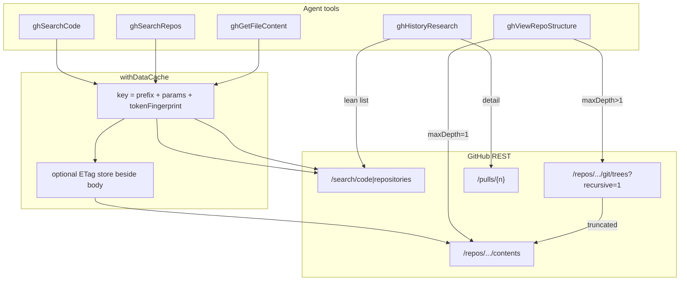

# RFC: GitHub REST API Efficiency — Trees, Cache Hygiene, Conditional Requests

| Field | Value |
|-------|-------|
| **Status** | Accepted — Phases A–D landed (2026-07-11); Phase C ETag soft-cache + conditional GET |
| **Decision type** | Reversible (two-way door) — feature-flag / depth-threshold + keep Contents fallback |
| **Author(s)** | cursor-gh-issues (research 2026-07-11); impl cursor-gh-api-eff; Phase C cursor-tool-fixall |
| **Created** | 2026-07-11 |
| **Last Updated** | 2026-07-11 |
| **Package** | `@octocodeai/octocode-tools-core` (+ thin CLI/MCP schema text if needed) |
| **Related landed** | `ghHistoryResearch` `type:"issues"` + history/releases/issues TTL cache (2026-07-11) |

> Full folder RFC: cross-cutting GitHub transport + cache contracts for research tools. **Phases A/B/C/D implemented 2026-07-11**.

---

## Summary

Keep GitHub research tools on **REST Octokit**. Do **not** introduce GraphQL for code/repo search, file fetch, or structure. Ship a phased REST efficiency program: (1) **cache-key correctness + auth scoping**, (2) **`ghViewRepoStructure` via recursive Git Trees** when deep, (3) **ETag / If-None-Match** on file and structure refresh, (4) **lean PR-search enrichment** (skip per-hit `pulls.get` on triage lists). Success is measured in GitHub call counts and cache correctness tests, not a transport rewrite.

---

## Goals and Non-Goals

### Goals

1. **Correct cache keys** for every query-affecting field on repo search (and remaining gaps on issues), plus **token fingerprint** in GitHub API cache keys so private/auth visibility cannot cross-contaminate.
2. **Deep structure ≤ ~2 REST calls** for typical `maxDepth > 1` requests via `GET …/git/trees/{sha}?recursive=1`, with Contents API retained as fallback when trees are truncated or shallow depth=1 is cheaper.
3. **Conditional GETs** for file content and structure: authorized **304 Not Modified** reuses body without primary quota burn (GitHub documented behavior).
4. **Lean PR list**: `ghHistoryResearch` search path must not call `pulls.get` per hit unless detail/content flags require enrichment.
5. Preserve existing agent contracts: tool names, bulk queries, pagination envelopes, `incompleteResults` / partial-tree warnings.

### Non-Goals

- GraphQL client or dual REST+GraphQL paths for `ghSearchCode`, `ghSearchRepos`, `ghGetFileContent`, `ghViewRepoStructure`.
- GraphQL code search (impossible: GraphQL `SearchType` has no `CODE`).
- Redis / multi-process shared cache.
- Webhook-driven invalidation.
- OQL `target:issues` / new MCP tools.
- Rewriting minify / concise finalizers (orthogonal).
- Changing GitHub search rate limits (platform constraint).

---

## Motivation

### Problem

Agent research loops hammer GitHub REST. Three classes of waste are proven in-tree:

1. **Wrong/stale cache hits** — repo search cache key omits filters that change `q`.
2. **O(#directories) structure walks** — recursive Contents `getContent` with no Git Trees API.
3. **N+1 PR enrichment** — search triage still `pulls.get`s every hit.

Plus **no ETag**, so TTL expiry always pays a full GET even when content is unchanged.

### Current state (evidence)

| Area | Behavior | Anchor |
|------|----------|--------|
| Code search | `search.code` + text-match; cached `gh-api-code` 3600s | `src/github/codeSearch.ts` |
| Repo search | `search.repos` or org/user list; cache key incomplete | `src/github/repoSearch.ts:68-83` |
| Structure | Recursive `repos.getContent` only; no `git.getTree` | `src/github/repoStructureRecursive.ts` |
| File fetch | `getContent`/`getBlob`; TTL 300s; no ETag | `src/github/fileContent*.ts` |
| Directory fetch | `download_url` bypasses in-memory file cache | `src/github/directoryFetch.ts` |
| PR search | Per-hit `pulls.get` on search path | `src/github/prContentFetcher.ts:310-319` |
| GraphQL | Zero live calls; error typing only | `src/github/` — no `.graphql(` |
| Issues (landed) | `type:"issues"` + `gh-api-issues` cache | `src/github/issues.ts` |

### Impact

- Agents on monorepos: deep `ghViewRepoStructure` can burn hundreds of REST calls / secondary-limit risk.
- Auth mixing: process-wide cache without token scope can serve wrong visibility.
- PR triage: ~30 extra `pulls.get` per page of search results.

### Use cases

- Orient: `ghViewRepoStructure` depth 2–3 on large repos.
- Discover: `ghSearchRepos` with `archived`/`visibility`/`forks` filters must not collide in cache.
- Triage: `ghHistoryResearch` concise PR list without SHA/draft enrichment cost.
- Re-read: repeated `ghGetFileContent` after TTL should 304 when unchanged.

---

## Guide-Level Explanation

After this ships:

**Structure.** For `maxDepth > 1`, Octocode resolves the branch tip once, calls **recursive git trees**, maps entries to the existing structure item shape, then paginates client-side as today. If GitHub returns `truncated: true`, Octocode falls back per §Unresolved Questions policy. Depth 1 stays on a single `getContent` (cheapest).

**Cache.** Changing `archived`, `forks`, or auth token changes the cache key. Agents never see another user’s private repo results from a shared MCP process cache entry.

**Conditional fetch.** On TTL miss, file/structure requests send `If-None-Match` with the stored ETag. A 304 returns the previous body and counts as a cache hit for stats.

**Lean PRs.** Concise / list PR search returns search-index fields only. Detail (`prNumber` or `content.*`) still hydrates via `pulls.get`.

No new tool names. Optional internal flag `OCTOCODE_GH_STRUCTURE_TREES=0` disables trees during rollout.

---

## Reference-Level Explanation

### Architecture

### Phase A — Cache hygiene (correctness)

**What:** Extend `generateCacheKey` payloads:

- `repoSearch.ts`: include `repo`, `archived`, `visibility`, `forks`, `license`, `goodFirstIssues` (every field `buildRepoSearchQuery` reads).
- `issues.ts`: include `archived`.
- All GitHub `withDataCache` entrypoints: include **stable token fingerprint** (reuse `hashToken` from `client.ts`) or `"anon"` when unauthenticated.

**Why:** Incomplete keys are a correctness bug, not an optimization.

**Compatibility:** Transparent; may increase cache miss rate (correctness > hits). Prefer bumping cache `VERSION` in `cache.ts` so old poisoned entries expire immediately.

### Phase B — Structure via Git Trees

**What:** In `viewGitHubRepositoryStructureAPI` / recursive path:

1. Resolve ref SHA (`repos.get` / `getBranch` / existing branch cache).
2. `octokit.rest.git.getTree({ owner, repo, tree_sha, recursive: 'true' })`.
3. Filter to `path` prefix + depth ≤ `maxDepth`.
4. Map to `GitHubApiFileItem[]`; reuse `applyStructurePagination` + ignore filters.
5. If `truncated === true`: apply truncated-tree policy (see open questions).

**Depth=1:** keep single `getContent`.

**Remove:** duplicate root `getContent` when recursion starts.

**Why:** Validated call reduction ~O(dirs) → ~2.

**Compatibility:** Same tool I/O; tests pin shape/filters, not absolute GitHub call counts except in instrumented unit tests with mocks.

### Phase C — ETag conditional requests

**What:** Store `{ data, etag }` for `gh-api-file-content` and `gh-repo-structure-api` (and/or tree responses). On refresh: `If-None-Match`. On 304: return prior body; count as hit.

**Why:** TTL alone re-fetches unchanged blobs. GitHub: authorized 304 does not count against primary rate limit.

**Compatibility:** Transparent; `forceRefresh` skips conditional and overwrites.

### Phase D — Lean PR search enrichment

**What:** In `transformPullRequestItemFromSearch`, call `pulls.get` only when detail/content/reviewMode needs fields absent from search items. Lean list / `concise:true`: search fields only.

**Why:** ~30 fewer REST calls per triage page.

**Compatibility:** Document lean field set; skills that need draft/additions use `prNumber` or `content`.

### Related medium items (same RFC, later phases)

| Item | Phase |
|------|-------|
| Directory fetch populate / reuse `gh-api-file-content` | E |
| Contents 1000-entry dir paging or tree for that dir | B companion |
| Search-bucket pacing (code vs search) | F (metrics first) |
| Repo `incomplete_results` warning | A companion |
| Owner-list `sort:stars` docs or client sort | A companion |
| Cap PR commit `getCommit` with `mapPool` | D companion |

---

## Drawbacks

- Trees API large payloads for huge monorepos (mitigate: depth filter; truncated handling).
- Lean PR lists lose some fields agents may have relied on implicitly (mitigate: document + detail path).
- Auth in cache keys increases misses after token refresh (acceptable).
- ETag storage increases cache value size slightly.
- Multi-file blast radius; structure pagination/ignore filter regressions.

### Pre-mortem

| Failure | Trigger | Mitigation |
|---------|---------|------------|
| Incomplete tree presented as complete | `truncated: true` ignored | Warning + policy fallback |
| Wrong structure vs Contents | Path/depth filter bug | Golden fixtures vs Contents for small repos |
| Lean PR regresses agent skills | Skill assumes draft/additions on list | Docs + optional enrich; eval |
| Cache never hits after auth key | Fingerprint unstable | Hash raw token once like `client.ts` |
| 304 mishandled as error | Octokit throws on 304 | Accept 304 / catch and map |

---

## Rationale and Alternatives

### Why this design?

Evidence-backed ROI: **correctness (keys)** → **structure call collapse (trees)** → **free refresh (ETag)** → **PR N+1**. GraphQL rejected for these surfaces: code search has no GraphQL result type; REST trees already solve structure.

### Alternatives considered

#### A: Do nothing
- **Pros:** No risk.  
- **Cons:** Known cache bugs and structure cost remain.  
- **Why not:** Validated bugs + call waste.

#### B: GraphQL-first for structure/content/search
- **Pros:** Nested field selection.  
- **Cons:** No code search; dual stack; Blob truncation; secondary limits shared.  
- **Why not:** Feasibility fail on code search; REST trees suffice for structure.

#### C: Only increase TTLs
- **Pros:** Trivial.  
- **Cons:** Wrong keys still poison; deep structure still O(dirs) on miss.  
- **Why not:** Paper over bugs.

#### D: Always clone for structure
- **Pros:** Local tree cheap after clone.  
- **Cons:** Wrong default for remote orient.  
- **Why not:** Keep clone opt-in; trees fix remote path.

---

## Unresolved Questions

1. Exact **depth/width threshold** for trees vs Contents (recommend: always `maxDepth > 1`)?
2. On `truncated: true`, **Contents fill** vs **warn + partial** only?
3. Lean PR: explicit **`enrich:true`** override, or only `content` / `prNumber`?
4. ETag store: **inline in cache value** vs parallel map?
5. Token fingerprint: hash of raw token only, or include host for GHES?

---

## Prior Art / References

See `RESOURCES.md`. Decisive external claims: GitHub REST best practices (conditional requests); Git Trees recursive API; GraphQL SearchType lacks CODE.

---

## Success Criteria (pointer)

Measurable acceptance: **`KPI.md`**. Build steps: **`IMPLEMENTATION.md`**. Baseline gates: **`PREREQUISITES.md`**.
