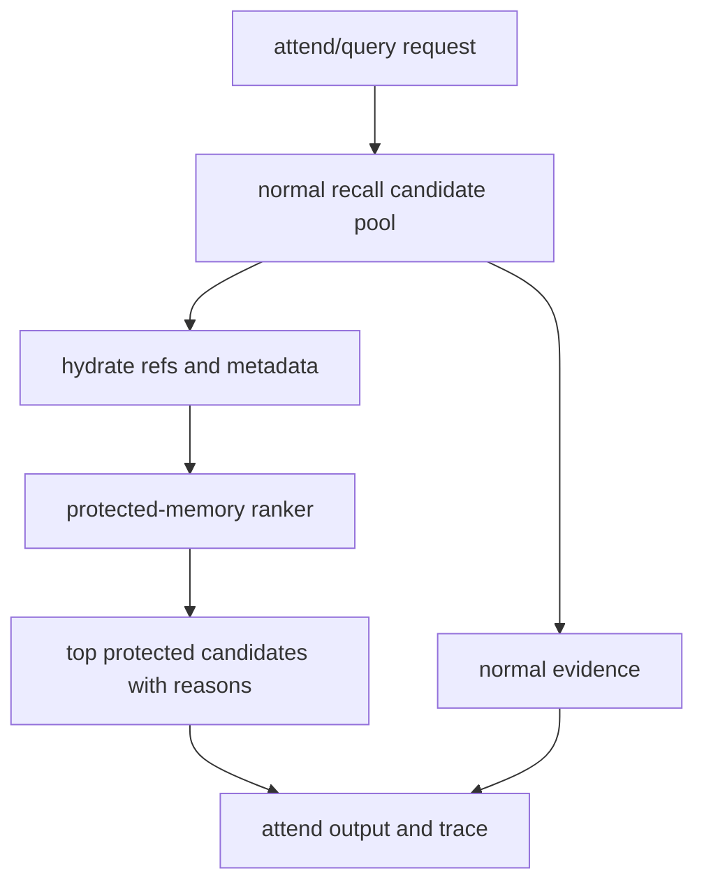

# RFC: HOLA-Inspired Protected Memory for Octocode Awareness

> **Dependency note (2026-07-10):** this remains a follow-on ranking experiment after core v4 and its lossless-memory gate. HOLA is model-level KV-cache evidence, not a cutover requirement; see [`awareness-operational-trust`](../awareness-operational-trust/RFC.md).

| Field | Value |
|-------|-------|
| **Status** | Draft |
| **Decision type** | Reversible (two-way door) |
| **Author(s)** | Guy + Codex |
| **Created** | 2026-07-09 |
| **Last Updated** | 2026-07-10 |

## Audit Reasoning — kept (2026-07-12)

**Status:** Not implemented — 0% shipped. No `protected_memory` field on `attend`, no `rankProtectedMemories`/`protected-memory` code anywhere in `packages/octocode-awareness`.
**Why kept:** Explicitly scoped as a deferred, low-commitment ranking experiment (derived-only, no schema migration) — the RFC already defers itself pending other work, so it is not stale, just not yet started.
**Correction needed:** the dependency note above points at `awareness-operational-trust`'s v4 lossless-memory gate, which is obsolete (see that RFC's own Audit Reasoning note) — rebase onto the current memory model before resuming.

## Summary

Prototype a HOLA-inspired protected-memory lane for `@octocodeai/octocode-awareness`.

The current awareness store already has long-lived memories, references, novelty scores, lexical recall, optional semantic recall, and `attend` as a compact context-gathering entrypoint. The missing piece is an explicit read path for facts that are likely to be important, exact, and easy for the normal scoring path to bury under recency, repeated phrasing, or high-volume workspace activity.

This RFC proposes a deterministic derived ranking, not a second canonical store. Delivery is phased: an **optional POC** to prove ranking lift on fixtures, then an **MVP** that ships a read-only `protected_memory` surface through `attend` with explainable reasons. V0 computes protected-memory candidates from existing `memories`, `memory_refs`, and FTS data — no schema migration.

## Document Set

- `RFC.md`: decision, tradeoffs, prior art, open questions, functionality explanation (SSOT).
- `PREREQUISITES.md`: current-state evidence and readiness checks.
- `IMPLEMENTATION.md`: optional POC → MVP → follow-on steps; resolved design choices.
- `KPI.md`: acceptance criteria, POC/MVP gates, eval fixtures, metrics.
- `RESOURCES.md`: local code references, paper links, prior art, research artifacts.

## Goals

1. Define a protected-memory score over the existing awareness database.
2. Preserve exact details that normal recall may under-rank because of decoys, stale access, or noisy high-importance memories.
3. Integrate with `attend` without replacing normal recall or changing the canonical memory schema.
4. Prove the change with fixture-based Recall@3, MRR@3, trace, compact-output, and scope-safety tests.
5. Keep the first implementation deterministic, reversible, and understandable from CLI output.
6. Capture external resources and references so this does not drift into vague "agent memory" mythology.
7. Separate **optional POC** (prove lift) from **MVP** (ship usable attend surface) so the team can park after a failed spike without half-shipping UX.

## Non-Goals

- Implementing HOLA inside a model architecture, attention kernel, or KV cache.
- Adding a new canonical protected-memory table in v0.
- Requiring embeddings, a vector database, or a graph memory system.
- Making any memory undeletable or immune to existing forget/delete semantics.
- Auto-ingesting raw chat into long-term memory.
- Building a general memory platform competing with Mem0, Zep, Letta, or LangGraph.
- Making the POC mandatory before MVP when fixture evidence already exists from a prior spike.

## Current State

`octocode-awareness` already has useful ingredients:

- The memory schema stores `importance`, `novelty_score`, `last_accessed_at`, `access_count`, labels, references, failure signatures, validity windows, and optional embeddings (`packages/octocode-awareness/src/db.ts:262`).
- FTS recall computes candidates, applies BM25 and decay/importance scoring, hydrates references, sorts by configurable modes, and can explain weak recall (`packages/octocode-awareness/src/memory.ts:288`, `:764`).
- Inserts already compute novelty against similar memories (`packages/octocode-awareness/src/memory.ts:552`).
- `attend` composes repo profile, workboard, projection health, recalled evidence, gaps, trace entries, trust warnings, organ state, and drive state (`packages/octocode-awareness/src/attend.ts:285`).
- Exact filters exist for references, files, file regex, query regex, workspace scope, and `asOf`.
- Optional semantic recall exists, but only when an embedding command is configured.

The gap is that these pieces are not assembled into a protected lane. Today, "important exact fact that was surprising when stored" and "currently lexical match with high current score" are mostly the same retrieval path. HOLA's lesson is that those are not the same.

**Baseline smoke (2026-07-10):** `attend --compact` and `memory-upgrades` Vitest suite (10 tests) pass against current code — protected ranking is not implemented yet; this is the pre-change baseline.

## Guide-Level Explanation — Functionality

Explain the proposal as if already shipped.

### What users / agents get

| Surface | Behavior |
|---|---|
| `attend --query "…" [--compact] [--explain]` | Normal `evidence` unchanged. When protected candidates exist, an optional `protected_memory` array appears with `id`, `text` (or compact id+reason), `protected_score`, and `reasons[]`. Trace names selection count and top reasons. |
| `memory recall` (optional post-MVP) | May gain `--protected` to dump the same ranker without attend orchestration. Not required for MVP. |
| Docs | `MEMORY_NAVIGATION.md` documents that "protected" means **ranking priority for exact/surprising facts**, not undeletable storage. |

### Mental model

```text
Normal recall  = "what matches the query well right now?"
Protected lane = "among relevant hits, which exact surprises must not get buried?"
```

Both lanes read the same SQLite rows. Protected is a **derived view**, not a second brain.

### Example (compact attend excerpt)

```text
evidence[]:
  - id=mem_recent_match  title=…
protected_memory[]:
  - id=mem_old_gotcha  protected_score=0.82
    reasons=novelty, exact_file_ref, gotcha_label
trace[]:
  - kind=protected_memory  selected=1
    top_reasons=novelty, exact_file_ref
```

### Teaching note

- Existing users keep using `attend` / `memory recall` as today.
- New behavior is additive and explainable; if `protected_memory` is empty, output looks like today.
- Forget/delete still apply — protected ranking never blocks `forgetMemory`.

## Delivery Phases (POC → MVP)

| Phase | Mandatory? | Purpose | Exit signal |
|---|---|---|---|
| **POC** | **No** — skip if fixtures + pure ranker already prove lift | Spike `rankProtectedMemories` + Vitest fixtures only; no CLI/attend UX | Recall@3 / MRR@3 lift on must-pass fixtures; or explicit park |
| **MVP** | **Yes** (if Decision accepted) | Ship attend `protected_memory` + trace + docs note + package tests green | KPI Definition of Done for v0 |
| Post-MVP | Optional | `--protected` on recall CLI, semantic blend, adaptive admission | Separate follow-ups |

POC is a cheap falsification gate. Failing POC parks the idea without attend UX debt. Passing POC (or skipping with equivalent fixture evidence) unlocks MVP.

## Proposal

Add a derived protected-memory selector.

At a high level:

```text
protected_score =
  query_relevance
  + novelty_score
  + importance
  + reference_trust
  + failure_signature_or_gotcha_boost
  + useful_access_signal
  - stale_or_superseded_penalty
  - scope_or_trust_risk_penalty
```

The selector should return:

- `id`
- `text`
- `score`
- `protected_score`
- `reasons`
- `refs`
- `labels`
- `updated_at`
- `trace`

The first version should be pure and deterministic. It can live as a helper beside memory recall or in a small dedicated module, but it should read from the existing store and reuse existing filters. No migration is required for v0.

## Flow



## Output Shape

V0 should expose protected candidates as an optional `protected_memory` section in `attend` output when `explain` or compact evidence generation is active. Normal `evidence` remains the default recall lane. This avoids silently changing the semantics of evidence ordering while making the protected lane debuggable.

If the output becomes too wide, compact mode can include only candidate IDs and reasons in `trace`, while full mode includes the protected rows.

## Alternatives

| Option | Description | Why not primary |
| --- | --- | --- |
| Do nothing | Keep current FTS and scoring only. | Does not test the HOLA insight or protect exact surprises from noisy recall. |
| Derived protected ranker | Compute protected candidates from the current store. | Chosen. Lowest blast radius and easiest to evaluate. |
| New protected-memory table | Persist a separate cache/table. | More complexity before proving ranking lift. |
| Semantic/vector-first retrieval | Lean on embeddings for all recall. | Optional embedder is not guaranteed, and exact refs/scope still matter. |
| External memory system | Adopt Zep, Mem0, Letta, or graph memory. | Larger product direction, more dependencies, unclear fit for local/offline awareness. |

## Prior Art

HOLA is the direct inspiration: preserve exact high-surprise details in a bounded auxiliary cache while the main compressed state handles broad continuity. Paper: https://arxiv.org/html/2607.02303v1

Adjacent systems inform boundaries:

- LangGraph separates short-term and long-term memory and highlights semantic, episodic, and procedural stores.
- Letta exposes archival memory as searchable long-term storage.
- Zep and Graphiti emphasize temporal graph memory.
- Mem0 frames memory across conversation, user, and organization scopes.
- Generative Agents and MemGPT popularized reflection, retrieval, and explicit memory hierarchy.
- TinyLFU/W-TinyLFU is relevant to admission policy: protect entries because they are valuable, not merely recent.

See `RESOURCES.md` for links, local `file:line` anchors, and search prompts.

## Risks

- Protected score could reward novelty even when the memory is irrelevant.
- Hot unrelated memories could dominate unless relevance remains mandatory.
- Scope leaks are possible if reference overlap is mishandled.
- Users may read "protected" as "undeletable"; docs and CLI wording must avoid that.
- Compact `attend` output can become noisy if protected candidates duplicate normal evidence.
- If the first eval is too synthetic, the feature may optimize to toy fixtures.
- Skipping POC without fixture evidence risks shipping attend UX before ranking lift is proven.

### Pre-mortem — how this fails

| Failure | Trigger | Mitigation |
|---|---|---|
| Novelty spam | High-novelty irrelevant rows | Relevance floor mandatory; fixture for irrelevant surprise |
| Scope leak | Shared ref values across workspaces | Reuse existing workspace filters before ranking |
| Compact bloat | Full text duplicated in evidence + protected | Compact emits ids/reasons only when overlap |
| Undeletable myth | Wording in docs/CLI | Explicit "ranking lane, not retention" copy |
| Overfit weights | Toy-only fixtures | Park if only synthetic lift; keep weights boring |

## Constraints

- V0 must not introduce a schema migration.
- V0 must not require `OCTOCODE_EMBED_CMD`.
- Existing recall, forget, and workspace-scope behavior must remain compatible.
- The feature must be measurable from local tests without network access.
- The implementation must keep SQLite as the canonical awareness store.

## Unresolved Questions

Before implementation:

- Exact initial score weights and caps. → closed in `IMPLEMENTATION.md` (initial boring weights).
- Whether `protected_memory` should appear by default or only with explain/compact attend paths. → closed: optional section when non-empty; prefer explain/compact paths for verbosity.

During implementation:

- Whether optional semantic recall should feed the protected candidate pool in v1. → deferred post-MVP.
- Whether trust warnings should suppress protected candidates or only annotate them. → annotate first; suppress only on scope/validity failure.

Out of scope for this RFC:

- Learned eviction/admission.
- Graph memory adoption.
- Model-layer cache integration.

## Decision

Proceed with a prototype RFC and fixture-driven implementation plan.

**Build path:** optional POC (ranker + fixtures only) → **MVP** (attend `protected_memory` + trace + docs + green package tests). Smallest useful version: a derived, explainable, read-only protected-memory lane over existing awareness data, surfaced through `attend`, guarded by tests, and measured against current recall. Resources and prior art live in `RESOURCES.md`.
